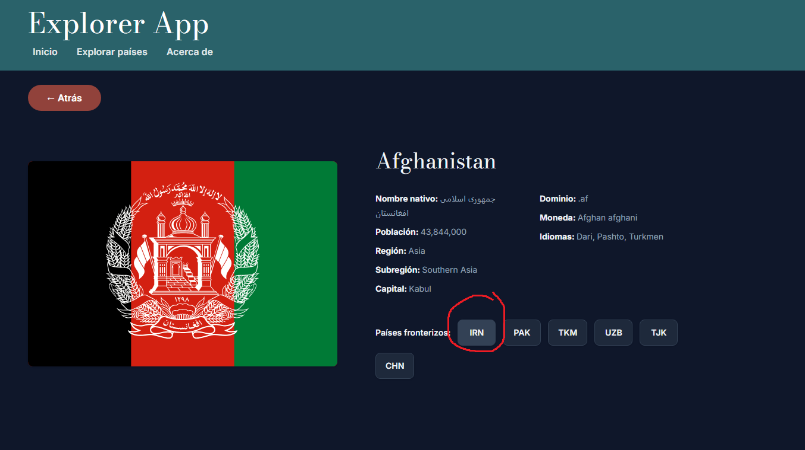
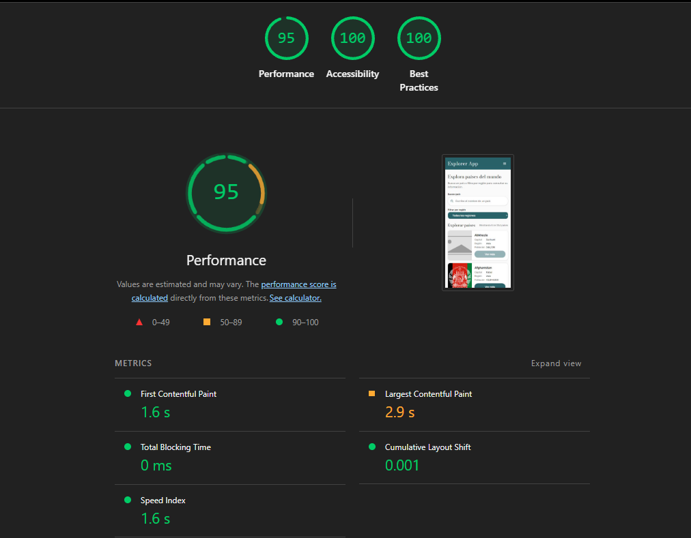

# Explorer React

**Explorer App** en React: una aplicación para explorar información de países. Permite buscar por nombre, filtrar por región, abrir el detalle de cada país y navegar entre países fronterizos, con diseño adaptable y modo oscuro automático.

Es la migración a React de la versión Vanilla TypeScript, que se conserva como referencia: [Explorer-APP---DWA](https://github.com/Javviee/Explorer-APP---DWA) (rama `LAB-2`).

- **Aplicación publicada:** https://explorer-react-delta.vercel.app/
- **Repositorio:** https://github.com/Javviee/explorer-react

## Funcionalidades

- **Listado** de países en tarjetas (bandera, nombre, capital, región y población): 4 por fila en pantallas amplias y una columna en móvil. Sin filtros se muestran 8 países destacados.
- **Búsqueda por nombre** con *debounce* de 300 ms y **filtro por región**, que funcionan por separado y combinados. Contador de resultados y botón «Limpiar filtros».
- **Estados de interfaz:** tarjetas *skeleton* durante la carga, mensaje de error con botón «Reintentar» y mensaje cuando no hay resultados.
- **Detalle de país** en `/country/:code`: bandera, nombre nativo, población, región, subregión, capital, dominio, moneda, idiomas y países fronterizos. Los campos que faltan muestran «No disponible».
- **Navegación sin recargar** con React Router: de la tarjeta al detalle, entre países fronterizos y de regreso al listado. Las URL directas funcionan, y una ruta o un código inexistente muestran un mensaje comprensible.
- **Menú adaptable:** navegación de escritorio y menú móvil con `aria-expanded`, cierre con Escape y al cruzar el breakpoint.
- **Modo oscuro** automático según la preferencia del sistema.

## Stack

- [React 18](https://react.dev/) y [TypeScript](https://www.typescriptlang.org/)
- [React Router v6](https://reactrouter.com/)
- [Vite](https://vite.dev/)
- [Tailwind CSS v4](https://tailwindcss.com/) (`@tailwindcss/vite`), con *design tokens* en `@theme` y Container Queries
- [pnpm](https://pnpm.io/) y ESLint
- Despliegue en [Vercel](https://vercel.com/) (`vercel.json` redirige las rutas de la SPA a `index.html`)

Los países se leen del archivo local `public/data/countries.json` (254 territorios, con el formato de REST Countries); no se usa ninguna API externa ni clave.

## Requisitos

- Node.js 22.12 o posterior
- pnpm

## Cómo ejecutar el proyecto

```bash
git clone https://github.com/Javviee/explorer-react.git
cd explorer-react
pnpm install
pnpm run dev
```

Abre la URL que muestre la terminal (por defecto `http://localhost:5173`).

Otros comandos:

```bash
pnpm run build     # comprueba los tipos y compila para producción (carpeta dist/)
pnpm run preview   # sirve la versión compilada
pnpm run lint      # revisa el código con ESLint
```

## Capturas

Listado, con la búsqueda `el` combinada con la región América ("Mostrando 5 de 254 países"):


Detalle de un país en escritorio (`/country/AF`):


Detalle de un país en móvil:


Navegación a un país fronterizo: el enlace **IRN** lleva a `/country/IR` sin recargar la página.



## Organización del código

### Componentes (Atomic Design)

| Nivel | Componente | Responsabilidad |
|---|---|---|
| Átomo | `Badge` | Muestra la región (con su etiqueta en español). |
| Átomo | `Flag` | Muestra una bandera y usa `placeholder.png` si falla o no hay URL. |
| Molécula | `CountryCard` | Tarjeta de un país: `Flag`, `Badge`, datos y botón «Ver más». |
| Molécula | `SearchBar` | Campo de búsqueda controlado (`value` y `onChange`). |
| Molécula | `RegionFilter` | Selector de región controlado; las opciones llegan por props. |
| Organismo | `CountryGrid` | Recorre un `Country[]` y crea una tarjeta por país. |
| Organismo | `Header` | Título y controles de búsqueda y filtro; transmite props sin estado propio. |
| Organismo | `SiteHeader` | Barra superior con navegación y menú móvil (estado local `isMenuOpen`). |
| Organismo | `CountryStates` | `LoadingState` (skeleton), `ErrorState` (Reintentar) y `EmptyState`. |

### Hooks

| Hook | Responsabilidad |
|---|---|
| `useCountries()` | Carga el catálogo: devuelve `state` (`loading`, `success` o `error`) y `retry`. Cancela la solicitud pendiente con `AbortController`. |
| `useSearch(countries)` | Guarda `query` y `region`, aplica el debounce de 300 ms y deriva las regiones y los países visibles. No hace `fetch`: recibe los países. |
| `useCountryDetail(code)` | Consulta un país por código cuando cambia la ruta, con estados de carga y error, reintento y descarte de respuestas obsoletas. |

### Rutas

| Ruta | Página |
|---|---|
| `/` | `HomePage`: listado, búsqueda y filtro. |
| `/country/:code` | `CountryDetailPage`: detalle del país (`useParams` y `useCountryDetail`). |
| `*` | `NotFoundPage`: dirección inexistente. |

Flujo de datos: `countries.json` → `useCountries()` → `useSearch()` → `HomePage` → `CountryGrid`. El estado de búsqueda vive en `useSearch` (dentro de `HomePage`); los controles hijos lo actualizan con callbacks.

### Estructura de carpetas

```
explorer-react/
├── index.html
├── vercel.json                Redirige las rutas de la SPA a index.html
├── public/
│   ├── data/countries.json    Catálogo local de países
│   ├── favicon.svg
│   └── placeholder.png        Imagen de respaldo si una bandera no carga
└── src/
    ├── main.tsx               Monta React con BrowserRouter
    ├── App.tsx                Cabecera y pie comunes y definición de rutas
    ├── index.css              Tailwind + design tokens (@theme) + tipografía fluida
    ├── api/countries.ts       fetchCountries y fetchCountryByCode (fetch tipado y validado)
    ├── components/            atoms/, molecules/ y organisms/
    ├── hooks/                 useCountries, useSearch y useCountryDetail
    ├── pages/                 HomePage, CountryDetailPage y NotFoundPage
    ├── types/                 Country y CountryDetail
    └── utils/                 filter, format, regions, country-codes y app-state
```

## Migración de Vanilla TypeScript a React

**Reutilizado sin cambios**
- Las funciones `formatPopulation`, `getCapital` y `getFlagDescription` (`src/utils/format.ts`), que no dependen del DOM. Su código es el mismo.
- Los *design tokens* de color, espaciado y tipografía (`@theme`), la tipografía fluida con `clamp()` y las Container Queries de la tarjeta. En React se añadieron los tokens del modo oscuro.
- `public/placeholder.png` como imagen de respaldo de las banderas.

**Adaptado**
- La interface `Country`: ahora usa `flag.url_svg` (campo del JSON local) en lugar de `url_png` y se quitó `emoji`. Además existe `CountryDetail` con los campos opcionales del detalle.
- El módulo de datos (`api/countries.ts`): la versión Vanilla consultaba la API REST Countries con paginación y clave. La versión React lee un JSON local, comprueba `response.ok` y **valida** la estructura antes de usarla.
- El *debounce* y el filtrado: en Vanilla eran utilidades (`debounce.ts`, `filters.ts`); en React son `useSearch` (con `useEffect`) y `filterCountries`.
- Los estados de carga, error y vacío: pasaron de cadenas HTML a los componentes de `CountryStates`.
- La navegación: el *hash routing* manual (`hashchange`) se sustituyó por React Router con `/` y `/country/:code`. Al usar rutas reales, el alojamiento necesita el *rewrite* de `vercel.json`.

**No reutilizado**
- `escapeHtml` y los renderers que devuelven cadenas HTML: JSX escapa el contenido y los componentes reemplazan a los renderers.

## Refactor y calidad

- **Hooks:** la carga y la búsqueda salieron de `App.tsx` a `useCountries` y `useSearch`; la consulta del detalle vive en `useCountryDetail`. `App.tsx` solo compone la estructura y las rutas.
- **Regiones en un solo lugar:** el mapa de etiquetas en español estaba solo en `RegionFilter`, y la tarjeta y el detalle mostraban «Americas». Ahora está en `src/utils/regions.ts` (`getRegionLabel`) y lo usan el selector, la tarjeta y el detalle.
- **Limpieza:** se eliminaron los datos de demostración, el `console.log` temporal y los `export` de tipos sin uso. No hay `any` ni supresiones de ESLint, y `pnpm run build` y `pnpm run lint` pasan sin errores.

## Medición con Lighthouse

Medición inicial de referencia sobre la aplicación publicada.

| Dato | Valor |
|---|---|
| URL | https://explorer-react-delta.vercel.app/ |
| Fecha | 23 de noviembre de 2026 |
| Modo | Navegación (carga de página), dispositivo móvil, Chrome DevTools |
| Performance | **95** |
| Accessibility | **100** |
| Best Practices | **100** |

Métricas: First Contentful Paint 1.6 s, Largest Contentful Paint 2.9 s, Total Blocking Time 0 ms, Cumulative Layout Shift 0.001 y Speed Index 1.6 s.



La métrica más débil es el LCP (2.9 s, en ámbar). Probablemente depende de las banderas de la primera fila, que se cargan desde un dominio externo y con carga diferida (`loading="lazy"`). Esa mejora queda como punto de partida para la siguiente unidad.

## Pendientes

- **Rendimiento:** mejorar el LCP (por ejemplo, cargar de inmediato las banderas visibles al inicio y precargar la conexión con el dominio de las banderas).
- **Búsqueda al volver al listado:** al regresar desde el detalle, la búsqueda y la región se reinician. Conservarlas exigiría subir el estado o guardarlo en la URL.
- **Territorios sin código:** Abkhazia, Northern Cyprus, Somaliland y South Ossetia no tienen `alpha_2`; su botón «Ver más» está deshabilitado porque no tienen una URL de detalle válida.
- **Subregión en inglés:** la subregión del detalle se muestra como llega en los datos.
- **Apariencia:** comparar con la versión Vanilla (por ejemplo, el ícono de perfil del encabezado, que no se migró) y revisar el contraste del foco en modo oscuro.
- **Pruebas:** la verificación fue manual; no hay pruebas automatizadas.
