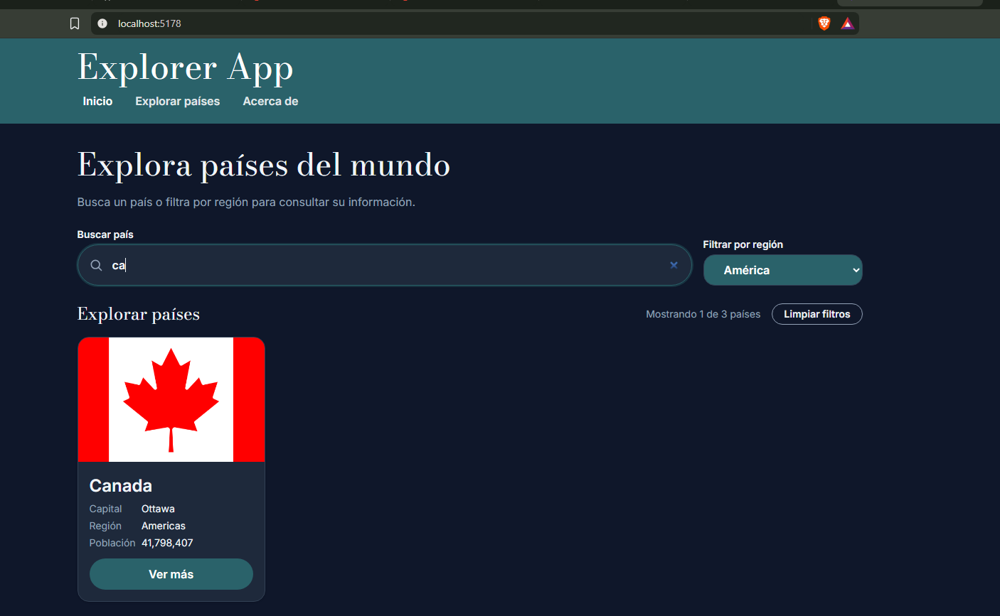
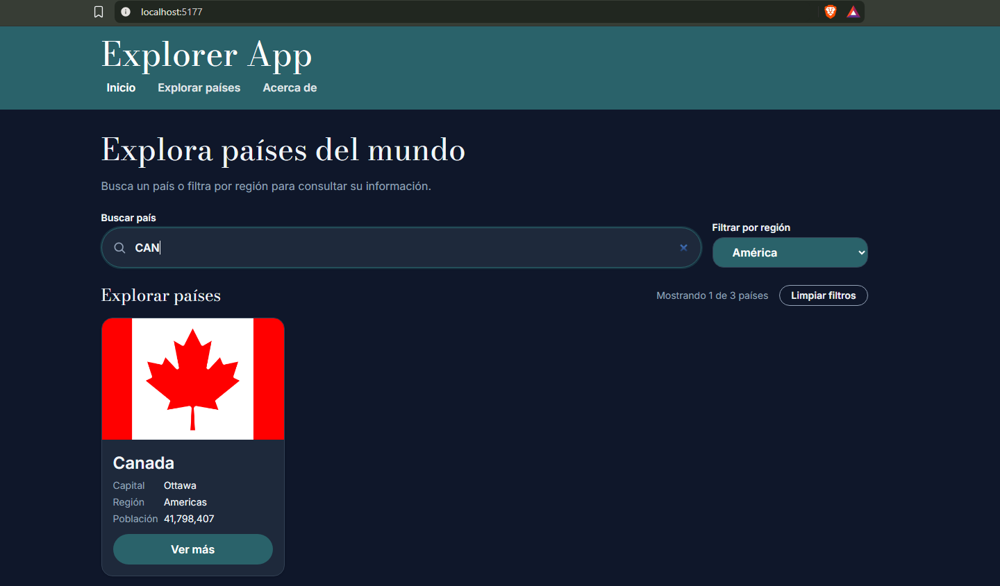
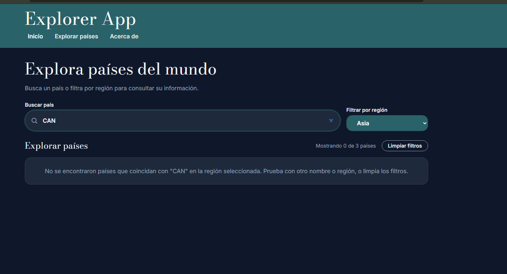
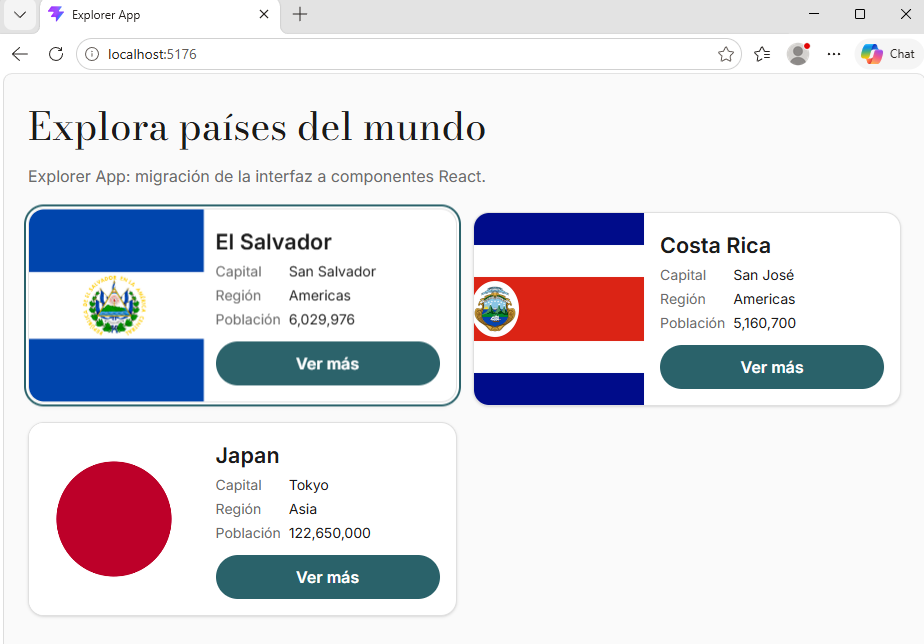
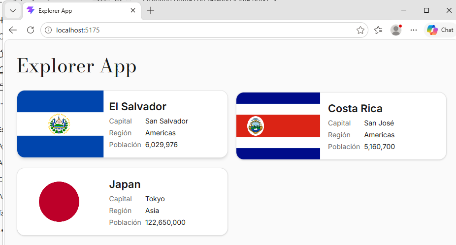
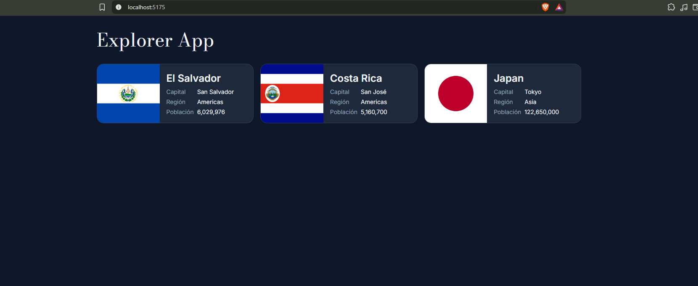

# Explorer React

Migración de **Explorer App** a React: interfaz para explorar información de países, construida con componentes funcionales, props tipadas y composición siguiendo Atomic Design.

Esta es la versión React del proyecto. La versión Vanilla TypeScript se conserva como referencia de la migración: [Explorer-APP---DWA](https://github.com/Javviee/Explorer-APP---DWA) (rama `LAB-2`).

## Estado actual (S27: componentes controlados para búsqueda y filtro)

- Nuevas moléculas `SearchBar` y `RegionFilter`: componentes **controlados** (reciben `value` y `onChange` tipados; no guardan estado).
- `Header` conserva `title` y `children` y ahora transmite `query`, `region`, `regions` y los callbacks a ambos controles.
- El estado (`query`, `region`) sigue en `App`, que es el único dueño; las regiones del selector se **derivan** de los datos con `Array.from(new Set(...)).sort()`, y la etiqueta en español se separa del valor (`Americas` → "América").
- Comportamiento igual que en S26: filtrado derivado, contador, mensaje sin resultados y **Limpiar filtros**.

## S26: useState, búsqueda reactiva y filtrado

- Búsqueda por nombre y filtro por región conectados al estado de React: `query` y `region` con `useState<string>("")`, enlazados al `input` y al `select` con `value` y `onChange` (eventos tipados).
- Los países visibles son un **resultado derivado**: `filterCountries(countriesDemo, query, region)` se recalcula en cada render desde la colección original, sin otro estado.
- Contador ("Mostrando X de Y países"), mensaje cuando no hay coincidencias y botón **Limpiar filtros** que restablece ambos estados.
- Nuevo `SiteHeader`: barra de navegación con menú móvil controlado por estado local (`isMenuOpen`), `aria-expanded`, cierre con Escape (devuelve el foco al botón) y al cruzar los 768 px.
- `CountryGrid` y `CountryCard` se conservan; "Ver más" sigue registrando el código del país en la consola.

Desde S25: interfaz organizada con Atomic Design (`Badge`, `Flag`, `CountryCard`, `CountryGrid`, `Header`), con `onSelect` como función prop, diseño adaptable, hover y modo oscuro automático según la preferencia del sistema.

Los países son datos locales de demostración (`src/data/countries-demo.ts`: El Salvador, Japan, Canada, Costa Rica, Germany y France); no se conecta la API ni se usa React Router en esta etapa.

## Atomic Design en este proyecto

| Nivel | Componente | Responsabilidad | Props |
|---|---|---|---|
| Átomo | `Badge` | Muestra la región como texto reutilizable. | `region: string` |
| Átomo | `Flag` | Muestra la bandera y usa `placeholder.png` si falla o no hay URL. | `src: string`, `alt: string` |
| Molécula | `CountryCard` | Combina `Flag`, `Badge` y los datos de un país. | `country: Country`, `onSelect: (code: string) => void` |
| Organismo | `CountryGrid` | Recorre un `Country[]` y crea una tarjeta por país. | `countries: Country[]`, `onSelect: (code: string) => void` |
| Molécula | `SearchBar` | Campo de búsqueda controlado con etiqueta e ícono. | `value: string`, `onChange` |
| Molécula | `RegionFilter` | Selector de región controlado; opciones recibidas por props. | `value: string`, `regions: string[]`, `onChange` |
| Organismo | `Header` | Título, contenido y controles de filtro; transmite props sin estado propio. | `title`, `children`, `query`, `region`, `regions`, `onQueryChange`, `onRegionChange` |
| Organismo | `SiteHeader` | Barra superior con navegación y menú móvil (estado local `isMenuOpen`). | Sin props |

## Qué hace `CountryGrid` y qué recibe

`CountryGrid` recibe un arreglo `countries: Country[]` y la función `onSelect`. Recorre el arreglo con `map()` y, por cada país, devuelve un `CountryCard` con `key={country.codes.alpha_2}`, el objeto `country` y la misma función `onSelect`. No conoce cuántos países hay ni de dónde vienen: si recibe dos, muestra dos tarjetas; si recibe cuatro, muestra cuatro.

## Cómo funciona la búsqueda reactiva

Al escribir en el campo, `onChange` llama a `setQuery(event.currentTarget.value)`. Esa llamada solicita a React actualizar el estado; React vuelve a ejecutar `App` con el nuevo `query` y vuelve a dibujar el JSX. `filteredCountries` se calcula en ese mismo render con `filterCountries(countriesDemo, query, region)`: como es un valor derivado de estados que ya existen y de una colección que no cambia, no necesita su propio `useState` (guardarlo duplicaría la información y podría desincronizarse). El filtro trabaja siempre sobre la colección original, así que limpiar la búsqueda conserva la región y cambiar la región conserva el texto.

La etiqueta visible del selector (por ejemplo, "América") es distinta del valor que se compara con los datos (`Americas`): se separa la presentación de la lógica.

## Seguimiento de la migración

| Elemento | Estado |
|---|---|
| Tipos, utilidades y recursos copiados | Reutilizados (`Country`, `format.ts`, `placeholder.png`); revisar contratos al conectar la fuente completa. |
| Tarjeta, bandera y región | Organizadas como componentes. |
| Listado de países | Preparado para recibir cualquier `Country[]`; comprobado con datos temporales. |
| Cabecera de navegación y menú móvil | Migrados en `SiteHeader` (estado `isMenuOpen`, `aria-expanded`, Escape y breakpoint de 768 px). Pendiente: ícono de perfil de la versión Vanilla. |
| Pie / "Acerca de" | Migrado como `<footer id="acerca-de">`, destino del enlace del menú. |
| Búsqueda y filtro por región combinados | Migrados con `useState` y `filterCountries`; controles extraídos en S27 a `SearchBar` y `RegionFilter` (estado en `App`). |
| Debounce de 300 ms | Pendiente: en esta fase el filtrado se ejecuta con cada cambio (`useState` no aplica debounce). |
| Catálogo completo, carga, vacío, error y reintento | Pendiente: conectar mediante el módulo de datos y los efectos de React. |
| Vista inicial de 8 países con catálogo completo para filtrar | Pendiente: distinguir entre todos los países cargados y la lista visible. |
| Detalle y navegación | Pendiente: integrar con el enrutamiento. |
| Tema claro/oscuro | Solo por preferencia del sistema (la versión Vanilla tampoco tenía interruptor). |
| Apariencia equivalente a la versión Vanilla | Pendiente: comparar colores, formas y componentes al terminar la migración. |

Nota: `key` usa `codes.alpha_2`. Al cargar el catálogo completo habrá territorios sin ese código (por ejemplo, Abkhazia), así que entonces se usará un identificador alterno para que la `key` siga siendo única.

## Resultado

Componentes controlados (S27): con `SearchBar` y `RegionFilter` extraídos, `can` + región América se comporta igual que en S26; el estado sigue en `App` y las regiones del selector se derivan de los datos.



Búsqueda y filtro combinados (S26): `can` + región América devuelve solo Canada; el contador muestra "1 de 6 países" y aparece el botón "Limpiar filtros".



Sin coincidencias (S26): `CAN` + región Asia no devuelve países y se muestra un mensaje en lugar de una cuadrícula vacía.



Pantalla de la sesión anterior (S25): `Header` y `CountryGrid` con tres tarjetas generadas desde el arreglo `countriesDemo`. La primera tarjeta muestra el foco al navegar con teclado.



Capturas de la sesión anterior (S24), antes de reorganizar los componentes:





## Stack

- [React 18](https://react.dev/) + [TypeScript](https://www.typescriptlang.org/)
- [Vite](https://vite.dev/)
- [Tailwind CSS v4](https://tailwindcss.com/) (`@tailwindcss/vite`), design tokens con `@theme`
- pnpm

## Requisitos

- Node.js 22.12 o posterior
- pnpm

## Cómo ejecutar el proyecto

```bash
git clone https://github.com/Javviee/explorer-react.git
cd explorer-react
pnpm install
pnpm run dev
```

Abre la URL que muestre la terminal (por defecto `http://localhost:5173`).

Otros comandos:

```bash
pnpm run build     # compila para producción (carpeta dist/)
pnpm run preview   # sirve la versión compilada
pnpm run lint      # revisa el código con ESLint
```

## Estructura de carpetas

```
explorer-react/
├── index.html
├── public/
│   ├── favicon.svg
│   └── placeholder.png        Imagen de respaldo si una bandera no carga
└── src/
    ├── main.tsx               Monta React e importa el CSS global
    ├── App.tsx                Compone la pantalla: Header + CountryGrid
    ├── index.css              Tailwind + design tokens (@theme) + tipografía fluida
    ├── components/
    │   ├── atoms/
    │   │   ├── Badge.tsx
    │   │   └── Flag.tsx
    │   ├── molecules/
    │   │   └── CountryCard.tsx
    │   └── organisms/
    │       ├── CountryGrid.tsx
    │       ├── Header.tsx
    │       └── SiteHeader.tsx
    ├── data/
    │   └── countries-demo.ts  Países de demostración y arreglo countriesDemo
    ├── types/
    │   └── country.ts         Interface Country (reutilizada de la versión Vanilla)
    └── utils/
        ├── filter.ts          filterCountries: filtra por nombre y región sin modificar el arreglo original
        └── format.ts          formatPopulation, getCapital, getFlagDescription (reutilizadas)
```

## Reutilizado de la versión Vanilla TypeScript

- La interface `Country` (`src/types/country.ts`).
- Las utilidades `formatPopulation`, `getCapital` y `getFlagDescription` (`src/utils/format.ts`), que no dependen del DOM.
- Los design tokens, la tipografía fluida con `clamp()` y las Container Queries de la tarjeta.
- No se reutilizan `escapeHtml` ni los renderers que devuelven strings, porque JSX escapa el contenido automáticamente.
