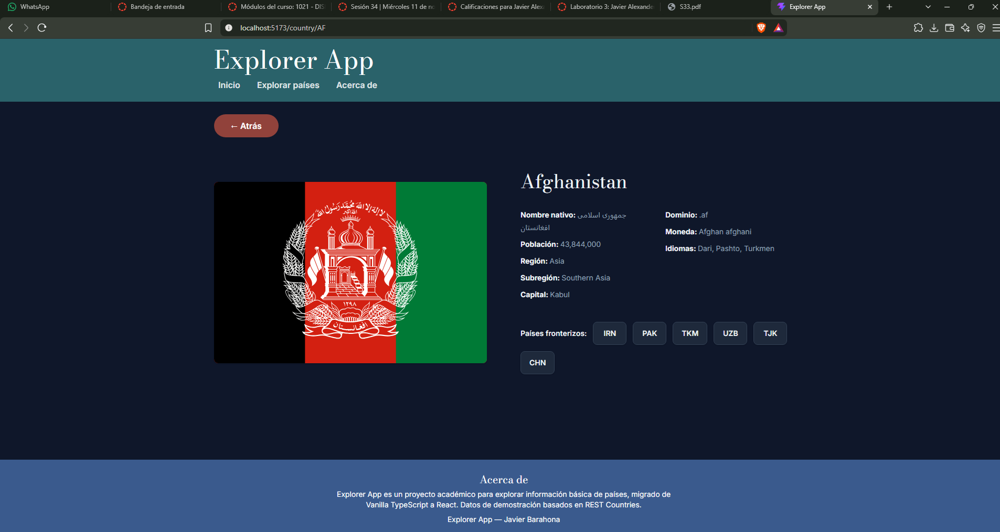
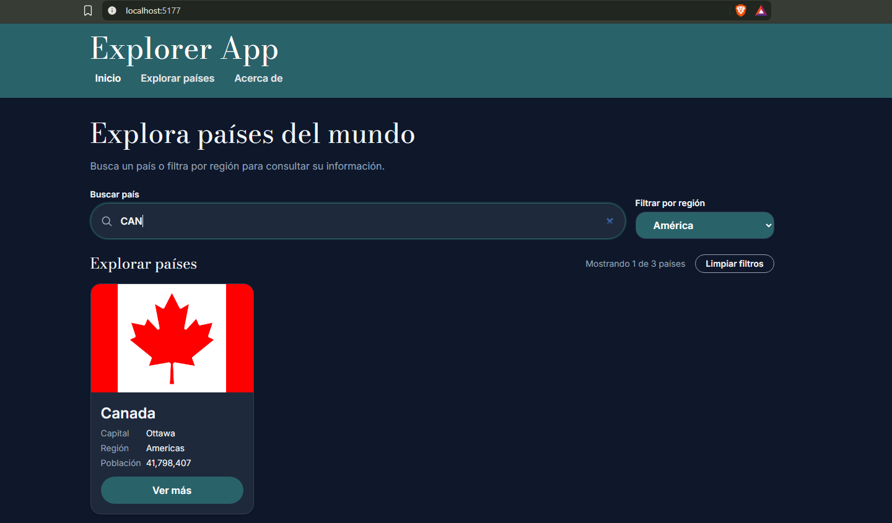
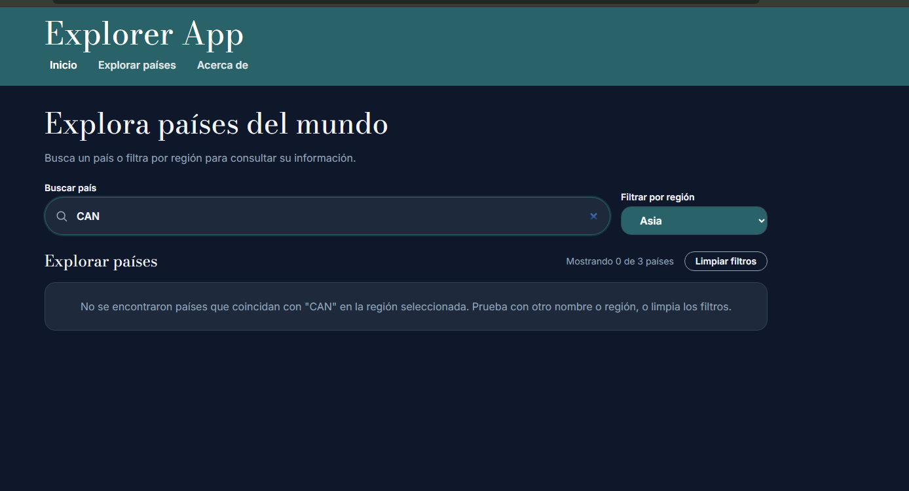
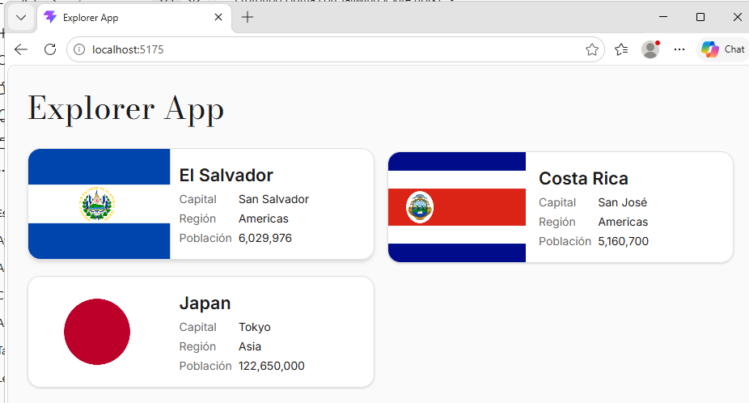

# Explorer React

Migración de **Explorer App** a React: interfaz para explorar información de países, construida con componentes funcionales, props tipadas y composición siguiendo Atomic Design.

Esta es la versión React del proyecto. La versión Vanilla TypeScript se conserva como referencia de la migración: [Explorer-APP---DWA](https://github.com/Javviee/Explorer-APP---DWA) (rama `LAB-2`).

## Estado actual (S33: página de detalle con `useParams`)

- `CountryDetailPage` (`/country/:code`) muestra el país de la URL: lee el código con `useParams<keyof CountryRouteParams>()` y lo entrega al hook `useCountryDetail`.
- **`useCountryDetail(code)`** consulta con `fetchCountryByCode`, gestiona `loading`, `error` y `success` (unión discriminada `CountryDetailState`), permite **Reintentar** y descarta respuestas anteriores con una marca `active`. El efecto depende del código y de un contador de reintentos.
- **`fetchCountryByCode`** (`src/api/countries.ts`) busca por `alpha_2` sobre una carga compartida del JSON: las fronteras no vuelven a descargar el archivo. Si falla, la siguiente consulta lo reintenta. Los campos opcionales del detalle (`tlds`, `currencies`, `languages`, `borders`, `subregion`) se validan cuando están presentes.
- **Fronteras:** el texto del enlace conserva las tres letras (por ejemplo `GTM`), pero el destino usa dos (`/country/GT`) mediante `getCountryRouteCode` (`src/utils/country-codes.ts`, 165 equivalencias comprobadas contra el JSON).
- Composición: botón «← Atrás» (`Link` a `/`), bandera grande a la izquierda y datos en dos columnas a la derecha en escritorio; en móvil, todo en vertical. Los datos opcionales muestran «No disponible» y un país sin fronteras muestra «Sin fronteras terrestres».
- Colores del proyecto: el botón «Atrás» usa el color de acento, las fronteras son botones claros (superficie) y el pie pasó a ser una franja azul (`secondary`) en todas las páginas.
- `Flag` acepta una `className` opcional para reutilizar la imagen con su respaldo (`placeholder.png`) en el detalle.

### Respuestas breves (autoevaluación S33)

1. **`useParams` y `fetchCountryByCode`:** `useParams` obtiene el valor del segmento `:code` de la URL (como `string | undefined`); no sabe si existe el país. `fetchCountryByCode` recibe ese código y devuelve el objeto `CountryDetail` correspondiente (o lanza un error si no existe).
2. **¿Por qué el efecto depende del código?** Al pasar de `/country/AF` a `/country/IR` React reutiliza la misma página; si el efecto no dependiera del código no consultaría el nuevo país.
3. **¿Qué evita `active` y qué no cancela?** Evita que una respuesta anterior reemplace el país actual (cada ejecución tiene su propia marca y el cleanup la pone en `false`). No cancela la solicitud ni la descarga compartida del JSON.
4. **`GTM` frente a `GT`:** son dos formas de identificar Guatemala. Los datos de fronteras usan tres letras, pero la consulta y la ruta usan dos, así que se muestra `GTM` y el destino es `/country/GT`.
5. **Responsabilidades:** el hook concentra la consulta y sus estados; la página lee la URL (`useParams`) y presenta el resultado según `status`.

## Estado anterior (S32: React Router v6)

- Navegación SPA con **React Router v6** (`react-router-dom`): `BrowserRouter` se configura una sola vez en `src/main.tsx`.
- Rutas definidas en `App.tsx` con `Routes` y `Route`:
  - `/` → `HomePage` (búsqueda, filtro por región y listado; usa `useCountries` y `useSearch`).
  - `/country/:code` → `CountryDetailPage` (página inicial: muestra el código recibido con `useParams`; el detalle completo se desarrolla en la siguiente sesión).
  - `*` → `NotFoundPage` para direcciones inexistentes.
- "Ver más" navega con `useNavigate()` a `/country/<código>` (el `alpha_2` de `Country`), sin recargar el documento; "Volver al listado" usa `Link`.
- `SiteHeader` usa `Link`/`NavLink`: la marca e "Inicio" llevan a `/` (con `aria-current` automático) y "Explorar países" a `/#paises`; "Acerca de" sigue siendo un ancla al pie, que está en todas las páginas.
- Los cuatro territorios sin código `alpha_2` tienen el botón "Ver más" deshabilitado, porque no tienen una URL de detalle válida.
- La estructura común (cabecera y pie) vive en `App.tsx`; cada página solo aporta su `<main>`.

### Qué pasa con la búsqueda al volver al listado

`HomePage` se desmonta al ir al detalle y se monta de nuevo al volver, así que `useSearch` crea un estado nuevo: la búsqueda y la región **no se conservan**. Extraer la lógica a un Custom Hook no comparte ni conserva el estado entre páginas. Para conservarlo habría que subirlo a un componente que permanezca montado, a un contexto o a la URL (por ejemplo, parámetros de búsqueda).

### Router frente al hash routing de la versión Vanilla

En Vanilla se escuchaba `hashchange` y se leía `location.hash` a mano (`#/country/SV`). Con React Router cada ruta se declara con `Route`, la URL es una ruta real (`/country/SV`) y los parámetros se leen con `useParams`. Al ser rutas reales, el servidor que publique la app debe devolver `index.html` para cualquier ruta (en Vercel, una regla de *rewrite*), o recargar `/country/SV` daría 404.

## Estado anterior (S30: Custom Hooks)

- La lógica que vivía en `App.tsx` se extrajo a dos Custom Hooks en `src/hooks/`, sin cambiar la interfaz ni el comportamiento.
- **`useCountries()`** encapsula la carga: estado de la petición (`AppState`), `useEffect` con `AbortController` y reintento. Devuelve `{ state, retry }` (interface `UseCountriesResult`).
- **`useSearch(countries)`** encapsula `query`, `region`, el debounce de 300 ms, las regiones disponibles, los 8 países iniciales y el resultado filtrado. No hace `fetch`: recibe los países. Devuelve `query`, `debouncedQuery`, `region`, `regions`, `hasFilters`, `visibleCountries`, `setQuery`, `setRegion` y `clearFilters` (interface `UseSearchResult`).
- `filterCountries()` sigue siendo una función utilitaria (no usa hooks) y los hooks la reutilizan.
- `App.tsx` queda como punto de integración: llama a los hooks, conecta `SearchBar`, `RegionFilter`, `CountryGrid` y los estados de interfaz con sus props de siempre.

Flujo: `countries.json` → `useCountries()` → `useSearch()` → `App.tsx` → `CountryGrid`.

### Respuestas breves (práctica S30)

1. **¿Qué permanece en `App.tsx`?** Integrar: llamar a los hooks, decidir qué estado de interfaz mostrar (carga, error, vacío o tarjetas) y conectar los componentes visuales con sus props y callbacks.
2. **¿Por qué `filterCountries()` no es un hook?** Solo recibe datos y devuelve un resultado; no usa `useState`, `useEffect` ni otros hooks. Una función utilitaria es suficiente y se puede probar y reutilizar sin React.
3. **¿Qué devuelve `useCountries()`?** `state`, que indica si la carga está en `loading`, `success` (con los países en `data`) o `error` (con un mensaje), y `retry`, que repite la carga incrementando el contador que es dependencia del efecto.
4. **¿Por qué no se hace `fetch` al cambiar el texto?** Porque los países ya están guardados en el estado de `useCountries`; `useSearch` solo recalcula el filtro sobre ese arreglo durante el render.
5. **Si dos componentes llaman a `useSearch()`, ¿comparten el texto?** No. Cada llamada crea su propia instancia de estado. Para compartirlo habría que llamarlo una sola vez y pasar los valores por props o usar otro mecanismo (por ejemplo, Context).

## Estado anterior (S29: useEffect y consumo de datos)

- Los países ya no son datos de demostración en el código: se cargan desde `public/data/countries.json` (254 territorios) con `fetch`, dentro de un `useEffect`. Solo se muestran 8 países destacados mientras no haya filtros; al buscar o filtrar se usa el catálogo completo.
- Servicio tipado `src/api/countries.ts` (`fetchCountries`): comprueba `response.ok`, recibe el JSON como `unknown` y **valida** su estructura antes de devolver `Country[]`. `App` no conoce los detalles de la solicitud.
- Estado de la carga modelado con una unión discriminada (`AppState` en `src/utils/app-state.ts`): `loading`, `success` (con `data`) o `error` (con `message`).
- Estados de interfaz (`CountryStates.tsx`): ocho tarjetas *skeleton* mientras carga, mensaje "No pudimos cargar los países" con botón **Reintentar** si falla, y "No hay resultados" si la búsqueda no coincide.
- Debounce de 300 ms en la búsqueda con un segundo `useEffect` (`setTimeout` + `clearTimeout`).
- El filtrado sigue siendo un valor derivado durante el render (`filterCountries`): no necesita efecto.
- El contrato `Country` ahora usa `flag.url_svg` (campo real del JSON).

### Cómo funciona la carga

Secuencia: render inicial (`loading`) → `useEffect` → `fetchCountries` → respuesta validada → `setState({ status: 'success', ... })` → nuevo renderizado.

- **Efecto de carga**, dependencias `[retryCount]`: se ejecuta al montar y cada vez que **Reintentar** incrementa `retryCount`. Su limpieza llama a `controller.abort()` y marca `active = false`, así una respuesta obsoleta nunca actualiza el estado.
- **Efecto de debounce**, dependencias `[query]`: cada pulsación reinicia un temporizador de 300 ms; la limpieza lo cancela con `clearTimeout`. Este efecto no vuelve a consultar el JSON: solo decide cuándo se aplica la búsqueda sobre los países ya cargados.
- En desarrollo, `StrictMode` ejecuta el efecto dos veces para comprobar que la limpieza funciona; por eso puede verse más de una solicitud solo en desarrollo.

### Respuestas breves (práctica S29)

1. **¿Por qué el filtro local no requiere `useEffect`?** Porque los países filtrados se calculan a partir de datos que ya están en el estado (`state.data`, `debouncedQuery`, `region`); es un cálculo del renderizado, no una sincronización con un sistema externo.
2. **¿Diferencia entre un 404 y una solicitud cancelada?** Un 404 es una respuesta del servidor que `fetch` no rechaza por sí sola: se detecta con `response.ok` y es un error de carga. Una solicitud cancelada la provoca la propia aplicación con `AbortController`; no es un fallo y no debe mostrar error.
3. **¿Qué hace `return () => controller.abort()`?** Es la función de limpieza: cancela la solicitud pendiente cuando el efecto deja de ser vigente (reintento o desmontaje), evitando que una respuesta antigua actualice el estado.
4. **¿Qué estados debe contemplar la interfaz?** Cargando (skeleton), error (mensaje y Reintentar), sin resultados (mensaje) y datos disponibles (tarjetas).
5. **Dependencias:** `[retryCount]` vuelve a cargar solo cuando se pulsa Reintentar; `[query]` reinicia el debounce en cada cambio del texto; un arreglo vacío `[]` ejecutaría el efecto una sola vez al montar.

## Estado anterior (S27: componentes controlados para búsqueda y filtro)

- Nuevas moléculas `SearchBar` y `RegionFilter`: componentes **controlados** (reciben `value` y `onChange` tipados; no guardan estado).
- `Header` conserva `title` y `children` y ahora transmite `query`, `region`, `regions` y los callbacks a ambos controles.
- El estado (`query`, `region`) sigue en `App`, que es el único dueño; las regiones del selector se **derivan** de los datos con `Array.from(new Set(...)).sort()`, y la etiqueta en español se separa del valor (`Americas` → "América").
- Comportamiento igual que en S26: filtrado derivado, contador, mensaje sin resultados y **Limpiar filtros**.

## S26: useState, búsqueda reactiva y filtrado

- Búsqueda por nombre y filtro por región conectados al estado de React: `query` y `region` con `useState<string>("")`, enlazados al `input` y al `select` con `value` y `onChange` (eventos tipados).
- Los países visibles son un **resultado derivado**: `filterCountries(...)` se recalcula en cada render desde la colección original, sin otro estado.
- Contador ("Mostrando X de Y países"), mensaje cuando no hay coincidencias y botón **Limpiar filtros** que restablece ambos estados.
- Nuevo `SiteHeader`: barra de navegación con menú móvil controlado por estado local (`isMenuOpen`), `aria-expanded`, cierre con Escape (devuelve el foco al botón) y al cruzar los 768 px.
- `CountryGrid` y `CountryCard` se conservan; "Ver más" sigue registrando el código del país en la consola.

Desde S25: interfaz organizada con Atomic Design (`Badge`, `Flag`, `CountryCard`, `CountryGrid`, `Header`), con `onSelect` como función prop, diseño adaptable, hover y modo oscuro automático según la preferencia del sistema.

Desde S29 los países se leen del archivo local `public/data/countries.json` (derivado de REST Countries); no se usa ninguna API de pago.

## Atomic Design en este proyecto

| Nivel | Componente | Responsabilidad | Props |
|---|---|---|---|
| Átomo | `Badge` | Muestra la región como texto reutilizable. | `region: string` |
| Átomo | `Flag` | Muestra la bandera y usa `placeholder.png` si falla o no hay URL. | `src: string`, `alt: string` |
| Molécula | `CountryCard` | Combina `Flag`, `Badge` y los datos de un país. | `country: Country`, `onSelect: (code: string) => void` |
| Organismo | `CountryGrid` | Recorre un `Country[]` y crea una tarjeta por país. | `countries: Country[]`, `onSelect: (code: string) => void` |
| Molécula | `SearchBar` | Campo de búsqueda controlado con etiqueta e ícono. | `value: string`, `onChange` |
| Molécula | `RegionFilter` | Selector de región controlado; opciones recibidas por props. | `value: string`, `regions: string[]`, `onChange` |
| Organismo | `Header` | Título, contenido y controles de filtro; transmite props sin estado propio. | `title`, `children`, `query`, `region`, `regions`, `onQueryChange`, `onRegionChange` |
| Organismo | `CountryStates` | `LoadingState` (8 skeleton), `ErrorState` (con Reintentar) y `EmptyState`. | `onRetry`; `query`, `hasRegion` |
| Organismo | `SiteHeader` | Barra superior con navegación y menú móvil (estado local `isMenuOpen`). | Sin props |

## Qué hace `CountryGrid` y qué recibe

`CountryGrid` recibe un arreglo `countries: Country[]` y la función `onSelect`. Recorre el arreglo con `map()` y, por cada país, devuelve un `CountryCard` con `key={country.codes.alpha_2 || country.names.common}`, el objeto `country` y la misma función `onSelect`. No conoce cuántos países hay ni de dónde vienen: si recibe dos, muestra dos tarjetas; si recibe cuatro, muestra cuatro.

## Cómo funciona la búsqueda reactiva

Al escribir en el campo, `onChange` llama a `setQuery(event.currentTarget.value)`. Esa llamada solicita a React actualizar el estado; React vuelve a ejecutar `App` con el nuevo `query` y vuelve a dibujar el JSX. `filteredCountries` se calcula en ese mismo render con `filterCountries(...)`: como es un valor derivado de estados que ya existen y de una colección que no cambia, no necesita su propio `useState` (guardarlo duplicaría la información y podría desincronizarse). El filtro trabaja siempre sobre la colección original, así que limpiar la búsqueda conserva la región y cambiar la región conserva el texto.

La etiqueta visible del selector (por ejemplo, "América") es distinta del valor que se compara con los datos (`Americas`): se separa la presentación de la lógica.

## Seguimiento de la migración

| Elemento | Estado |
|---|---|
| Tipos, utilidades y recursos copiados | Reutilizados (`Country`, `format.ts`, `placeholder.png`); revisar contratos al conectar la fuente completa. |
| Tarjeta, bandera y región | Organizadas como componentes. |
| Listado de países | Recibe cualquier `Country[]`; ahora alimentado desde `countries.json`. |
| Cabecera de navegación y menú móvil | Migrados en `SiteHeader` (enlaces con `Link`/`NavLink` desde S32) (estado `isMenuOpen`, `aria-expanded`, Escape y breakpoint de 768 px). Pendiente: ícono de perfil de la versión Vanilla. |
| Pie / "Acerca de" | Migrado como `<footer id="acerca-de">`, destino del enlace del menú. |
| Búsqueda y filtro por región combinados | Migrados con `useState` y `filterCountries`; controles en `SearchBar` y `RegionFilter`; desde S30 el estado vive en `useSearch`. |
| Debounce de 300 ms | Migrado en S29 con un segundo `useEffect` (`setTimeout` y `clearTimeout`). |
| Catálogo completo, carga, vacío, error y reintento | Migrados en S29: `fetchCountries` (validado), `AppState`, skeleton, error con Reintentar y mensaje sin resultados. |
| Vista inicial de 8 países con catálogo completo para filtrar | Migrada en S29: se carga el catálogo completo y se muestran 8 países mientras no haya filtros. |
| Detalle y navegación | Migrados en S32 y S33: rutas `/` y `/country/:code`, detalle con `useCountryDetail`, fronteras navegables y estados de carga y error. |
| Tema claro/oscuro | Solo por preferencia del sistema (la versión Vanilla tampoco tenía interruptor). |
| Apariencia equivalente a la versión Vanilla | Pendiente: comparar colores, formas y componentes al terminar la migración. |

Nota: el catálogo incluye cuatro territorios sin `alpha_2` (Abkhazia, Northern Cyprus, Somaliland y South Ossetia), por lo que la `key` usa `codes.alpha_2 || names.common`; sin bandera se usa `placeholder.png`.

## Resultado

Detalle del país (S33), escritorio: `/country/AF` muestra el botón «← Atrás», la bandera a la izquierda, los datos en dos columnas y las fronteras como enlaces.



Detalle del país (S33), móvil: la bandera pasa sobre la información y los datos se apilan en una columna.


Navegación por fronteras (S33): desde Afghanistan, el enlace **IRN** lleva a `/country/IR` (Iran) sin recargar la página; el texto conserva las tres letras y el destino usa el código de dos (`GTM` → `/country/GT`).


Carga de datos con `useEffect` (S29): el catálogo se lee de `public/data/countries.json` (254 países). La captura muestra la búsqueda `el` combinada con la región América: "Mostrando 5 de 254 países" y el botón "Limpiar filtros". Sin filtros se muestran 8 países destacados.


Componentes controlados (S27): con `SearchBar` y `RegionFilter` extraídos, `can` + región América se comporta igual que en S26; el estado sigue en `App` y las regiones del selector se derivan de los datos.


Búsqueda y filtro combinados (S26): `can` + región América devuelve solo Canada; el contador muestra "1 de 6 países" y aparece el botón "Limpiar filtros".



Sin coincidencias (S26): `CAN` + región Asia no devuelve países y se muestra un mensaje en lugar de una cuadrícula vacía.



Pantalla de la sesión S25: `Header` y `CountryGrid` con tarjetas generadas desde un arreglo de países. La primera tarjeta muestra el foco al navegar con teclado.


Capturas de la sesión anterior (S24), antes de reorganizar los componentes:




## Stack

- [React 18](https://react.dev/) + [TypeScript](https://www.typescriptlang.org/) + [React Router v6](https://reactrouter.com/)
- [Vite](https://vite.dev/)
- [Tailwind CSS v4](https://tailwindcss.com/) (`@tailwindcss/vite`), design tokens con `@theme`
- pnpm

## Requisitos

- Node.js 22.12 o posterior
- pnpm

## Cómo ejecutar el proyecto

```bash
git clone https://github.com/Javviee/explorer-react.git
cd explorer-react
pnpm install
pnpm run dev
```

Abre la URL que muestre la terminal (por defecto `http://localhost:5173`).

Otros comandos:

```bash
pnpm run build     # compila para producción (carpeta dist/)
pnpm run preview   # sirve la versión compilada
pnpm run lint      # revisa el código con ESLint
```

## Estructura de carpetas

```
explorer-react/
├── index.html
├── public/
│   ├── data/
│   │   └── countries.json     Catálogo local de países (fuente de datos de fetchCountries)
│   ├── favicon.svg
│   └── placeholder.png        Imagen de respaldo si una bandera no carga
└── src/
    ├── main.tsx               Monta React e importa el CSS global
    ├── App.tsx                Cabecera y pie comunes y definición de rutas (Routes y Route)
    ├── index.css              Tailwind + design tokens (@theme) + tipografía fluida
    ├── api/
    │   └── countries.ts       fetchCountries y fetchCountryByCode: fetch tipado, response.ok y validación
    ├── components/
    │   ├── atoms/
    │   │   ├── Badge.tsx
    │   │   └── Flag.tsx
    │   ├── molecules/
    │   │   ├── CountryCard.tsx
    │   │   ├── RegionFilter.tsx
    │   │   └── SearchBar.tsx
    │   └── organisms/
    │       ├── CountryGrid.tsx
    │       ├── CountryStates.tsx   LoadingState (skeleton), ErrorState (Reintentar), EmptyState
    │       ├── Header.tsx
    │       └── SiteHeader.tsx
    ├── pages/
    │   ├── HomePage.tsx       Ruta /: integra los hooks, el buscador, el filtro y el listado
    │   ├── CountryDetailPage.tsx   Ruta /country/:code: detalle del país (usa useCountryDetail)
    │   └── NotFoundPage.tsx   Ruta * para direcciones inexistentes
    ├── hooks/
    │   ├── useCountries.ts    Carga de países: state (AppState) y retry
    │   ├── useCountryDetail.ts  Consulta del detalle por código: state y retry
    │   └── useSearch.ts       Búsqueda, región, debounce de 300 ms y países visibles
    ├── types/
    │   ├── country.ts         Interface Country (flag.url_svg)
    │   └── country-detail.ts  CountryDetail: campos opcionales del detalle
    └── utils/
        ├── country-codes.ts   getCountryRouteCode: fronteras de 3 letras a código de ruta de 2
        ├── app-state.ts       AppState: loading | success | error
        ├── filter.ts          filterCountries: filtra por nombre y región sin modificar el arreglo original
        └── format.ts          formatPopulation, getCapital, getFlagDescription (reutilizadas)
```

## Reutilizado de la versión Vanilla TypeScript

- La interface `Country` (`src/types/country.ts`).
- Las utilidades `formatPopulation`, `getCapital` y `getFlagDescription` (`src/utils/format.ts`), que no dependen del DOM.
- Los design tokens, la tipografía fluida con `clamp()` y las Container Queries de la tarjeta.
- No se reutilizan `escapeHtml` ni los renderers que devuelven strings, porque JSX escapa el contenido automáticamente.
